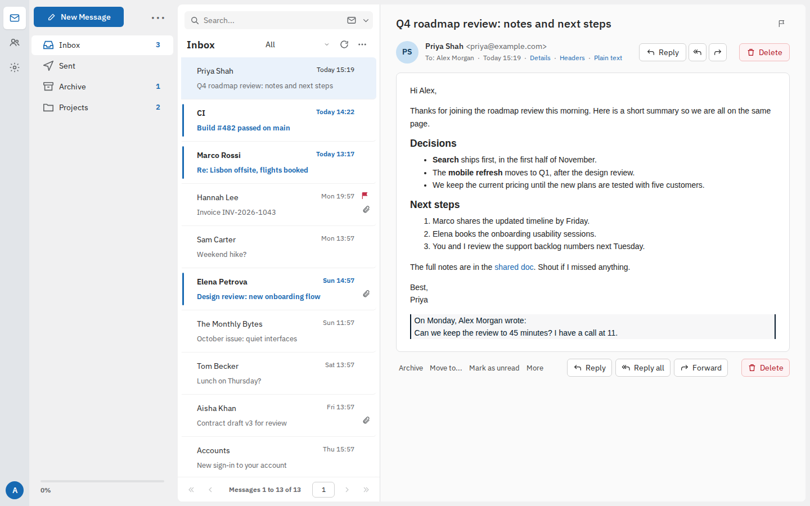
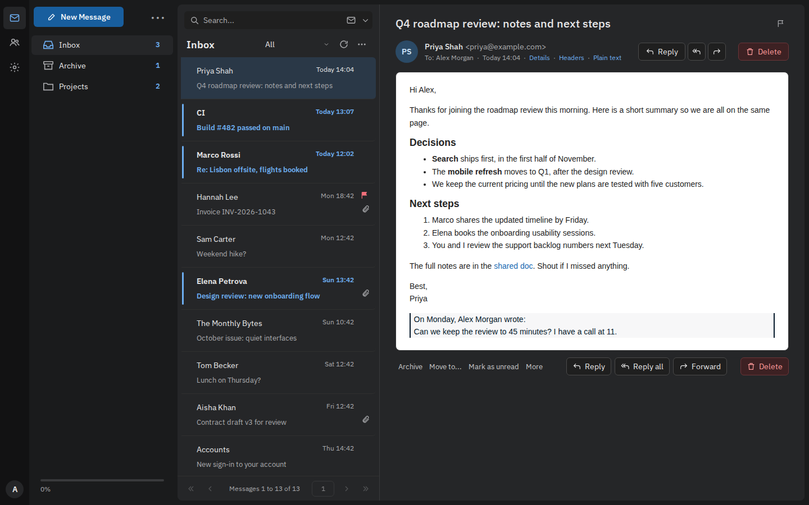
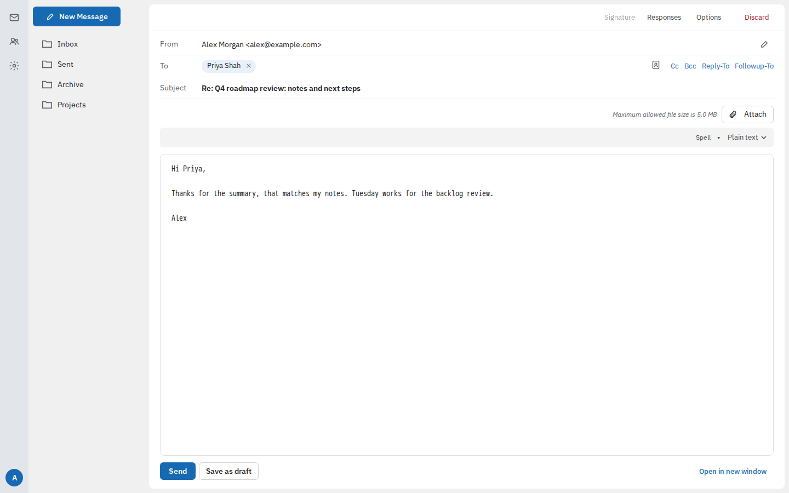
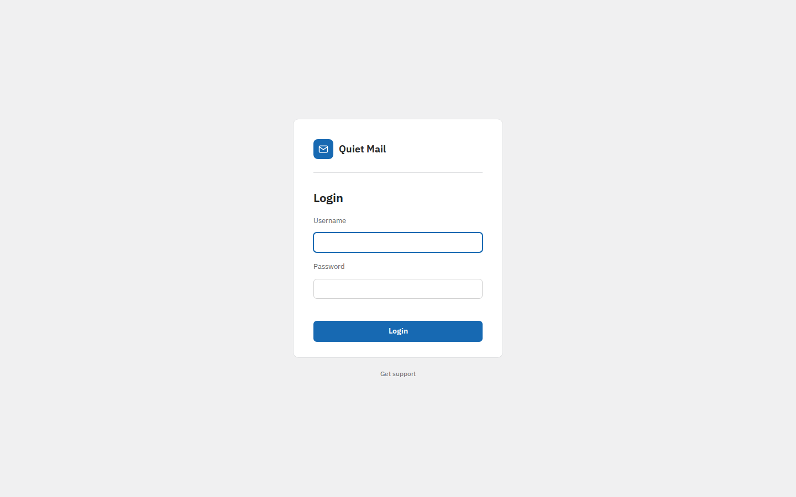
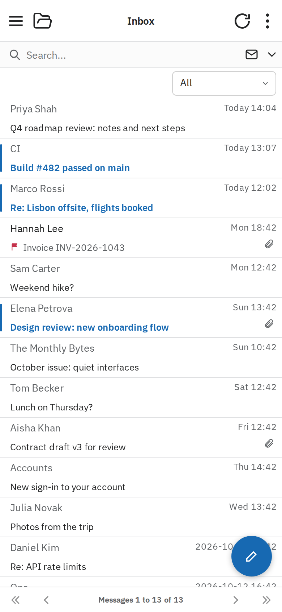
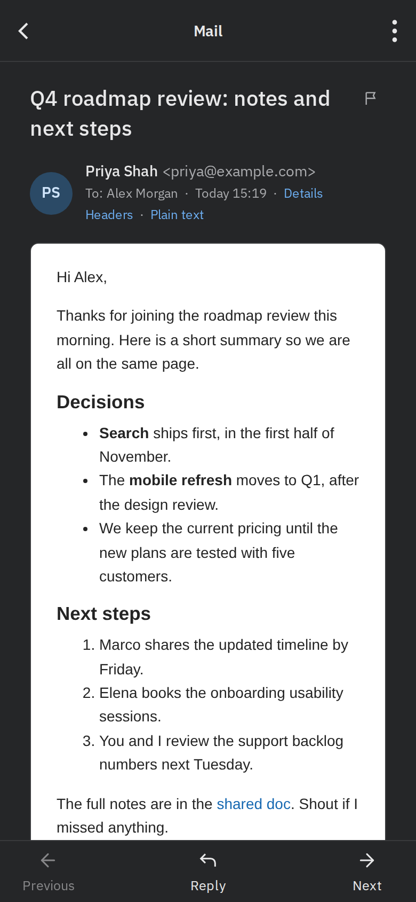
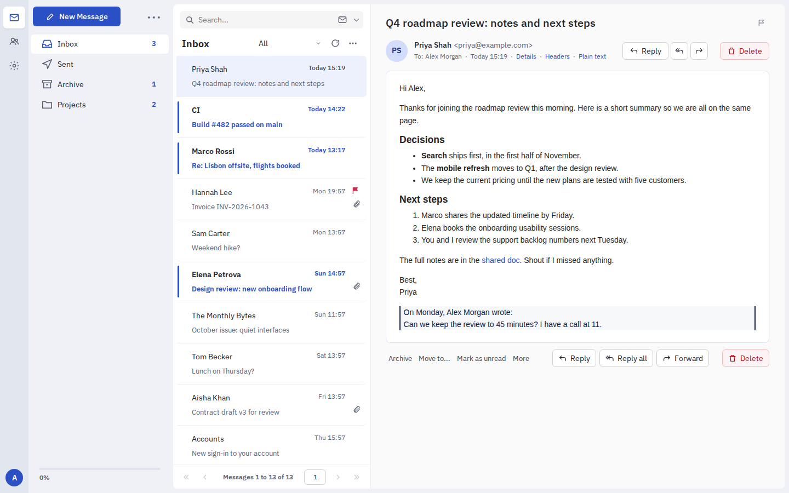
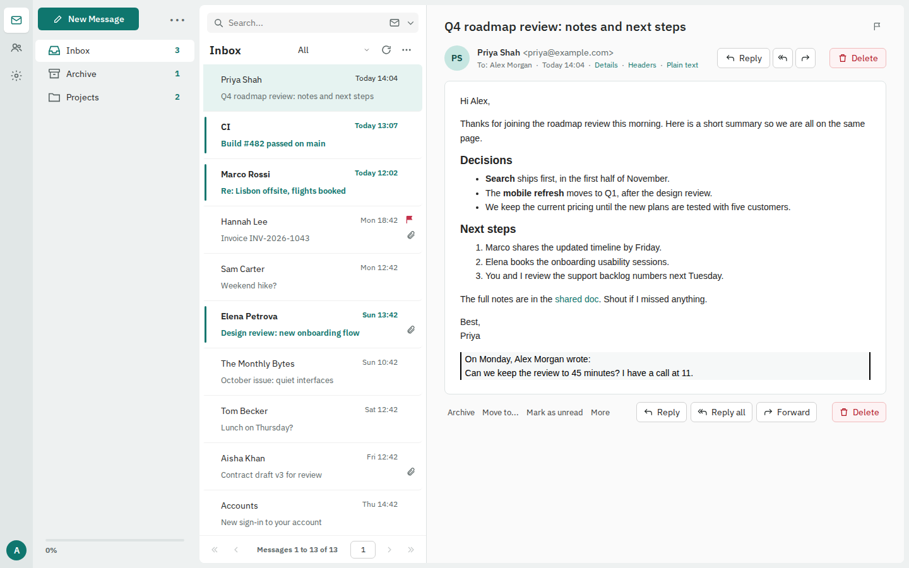
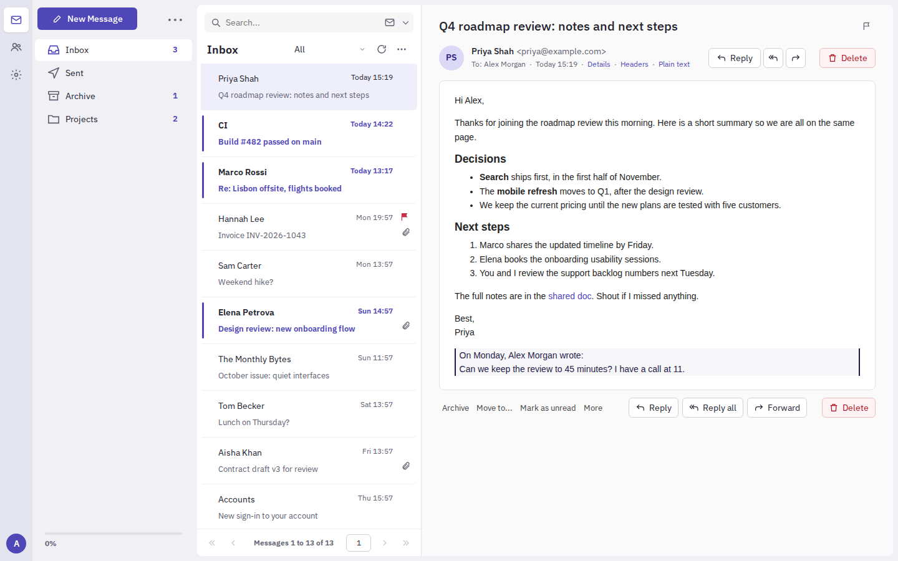

# Quiet

A calm skin for Roundcube Webmail 1.6 that extends Elastic. It restyles login, mail, the open message, compose,
contacts and settings, with a full dark mode and four colour schemes.

## Install

Requires Roundcube **1.6.x** (tested on 1.6.20) with the stock `elastic` skin present. Quiet uses CSS `:has()`,
so it needs a current browser. Roundcube 1.7 is not supported yet.

1. Copy the `skins/quiet` folder into your Roundcube's `skins/` directory, next to `skins/elastic`.
2. In Roundcube, open Settings > Preferences > User Interface and choose **Quiet**
   (or set `$config['skin'] = 'quiet';` for everyone).

No core patches or build step needed: the compiled CSS is committed. More (dark mode, colour schemes, known
limitations, upgrading Roundcube): [skins/quiet/README.md](skins/quiet/README.md).

## Screenshots

| Compose | Login |
| --- | --- |
|  |  |

| Phone: list | Phone: message (dark) |
| --- | --- |
|  |  |

Four colour schemes, picked from the account menu: Lake blue (default, above), Cobalt, Deep teal and Ink indigo.

| Cobalt | Deep teal | Ink indigo |
| --- | --- | --- |
|  |  |  |

## Contributing

The repo includes a Docker dev stack (Roundcube, throwaway test mail servers, LESS build, Playwright suite).
See [CONTRIBUTING.md](CONTRIBUTING.md). The design spec and mockups are in
[docs/specs/](docs/specs/2026-10-19-quiet-skin-design.md).

## Licence

- `skins/quiet/` (the skin itself): **CC BY-SA 3.0**, because it adapts Roundcube's Elastic skin, which uses that
  licence. Bundled fonts (OFL 1.1) and icons (ISC) keep their own licences. See
  [skins/quiet/LICENSE](skins/quiet/LICENSE).
- Everything else (dev stack, tests, tooling, docs): **public domain**, under [CC0 1.0](LICENSE).
